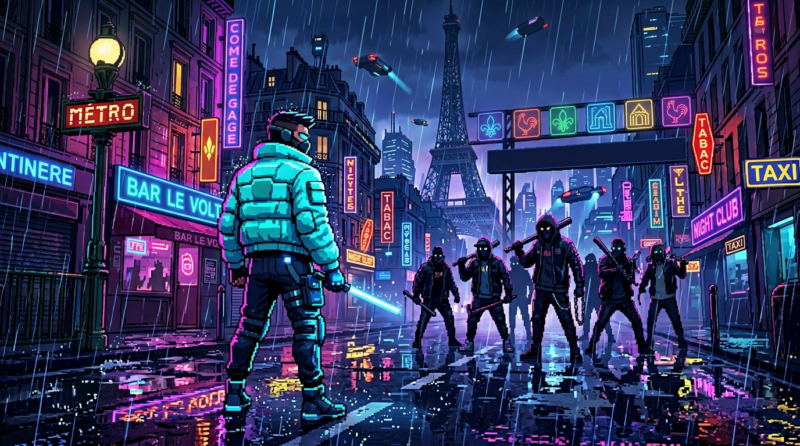

# Justice Urbaine

**Beat'em up 2.5D en scrolling horizontal, huit niveaux et un boss final.**

Justice Urbaine se joue au clavier, à la souris ou au doigt. Le joueur traverse huit quartiers, affronte sept types d'ennemis, ramasse des armes limitées et enchaîne les combos. Les graphismes sont vectoriels, l'ambiance est néon et la musique est synthétisée dans le navigateur.

Joue ici : [games.hylst.fr/justice-urbaine/](https://games.hylst.fr/justice-urbaine/)



## Contrôles

| Action | Clavier | Tactile |
|---|---|---|
| Se déplacer | ZQSD, WASD ou flèches | Joystick virtuel |
| Coup de poing | Espace ou J | Bouton POING |
| Coup lourd | Maj | Bouton dédié |
| Tirer | F | Bouton dédié |
| Dash | Maj et direction | Bouton dédié |
| Changer d'arme | Q ou E | Bouton dédié |
| Pause | P ou Échap | Bouton pause |
| Plein écran | non | Bouton plein écran |

## Fonctionnalités

- Huit niveaux, vagues progressives et boss final.
- Sept types d'ennemis, dont trois combattants à distance avec télégraphe visible.
- Trois armes limitées : pistolet, grenade balistique et couteau de jet.
- Combos, coup lourd, attaque spéciale, finisher et multiplicateur de score.
- Dash d'esquive avec invulnérabilité temporaire.
- Caisses et tonneaux destructibles, soins et munitions.
- Onboarding narratif en quatre écrans.
- Musique et effets sonores synthétisés avec Web Audio.
- Interface responsive, commandes tactiles et plein écran.

## Technique

- React 19, TypeScript, Vite 7 et Tailwind CSS 4.
- Rendu Canvas 2D, animations par squelette articulé.
- Build en un seul fichier `index.html`, images d'onboarding copiées dans `dist/`.
- Aucune requête réseau pendant la partie, aucun compte, aucun cookie.
- Aucune donnée conservée dans le navigateur.

```bash
npm ci
npm run build
```

Le build sort dans `dist/` et se sert sous `/justice-urbaine/`.

## Structure

```
src/App.tsx                 interface, HUD, onboarding et commandes tactiles
src/game/Game.ts            boucle de jeu, niveaux, vagues et collisions
src/game/InputManager.ts    clavier, souris et tactile
src/game/Fighter.ts         base commune des combattants
src/game/Player.ts          joueur, combos, dash et armes
src/game/Enemy.ts           sept types d'ennemis et leur IA
src/game/constants.ts       équilibrage, thèmes et niveaux
src/game/render/            personnages et décors
src/game/audio/AudioEngine.ts musique et effets synthétisés
```

## Licence

AGPL-3.0-or-later. Voir `LICENSE`.

Jeu créé par Geoffroy Streit (Hylst) avec l'aide d'une IA. Les illustrations d'onboarding ont été générées avec une assistance IA.
